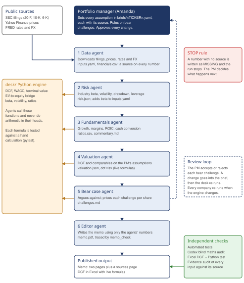

# AI Equity Research Desk

A team of six AI agents that produces a two-page buy/hold/sell investment memo on a listed company.
**Portfolio manager: Amanda.** She writes the brief, sets the assumptions, challenges the outputs and makes the final call.
Claude Code builds the desk, Codex independently audits the maths, and Amanda validates the key numbers against her own Excel model.

Student portfolio project, not investment advice.

## Start here

| Read | What it is |
|---|---|
| [Research pack (PDF)](publish/research-pack.pdf) | Cover page with the four calls, how the desk works, the four memos and the mistakes write-up, in one file |
| [What the AI agents got wrong](publish/what-the-agents-got-wrong.md) ([PDF](publish/what-the-agents-got-wrong.pdf)) | The 33 mistakes logged during the project, how each was caught, and the rules that came out of them |
| [Mistakes log](docs/mistakes-log.md) | Every error, row by row |

## The four calls (final, 15 October 2026)

| Company | Rating | Fair value | Share price | Upside | Memo |
|---|---|---|---|---|---|
| Diageo plc (LSE: DGE) | HOLD | 1,780.2p | 1,673p (12 Oct 2026) | +6.4% | [memo](runs/DGE/2026-10-12/editor/memo.pdf) |
| The Coca-Cola Company (NYSE: KO) | SELL | USD 50.25 | USD 90.12 (13 Oct 2026) | -44.2% | [memo](runs/KO/2026-10-13/editor/memo.pdf) |
| Unilever PLC (LSE: ULVR) | HOLD (borderline) | 4,258.5p | 4,710.5p (13 Oct 2026) | -9.6% | [memo](runs/ULVR/2026-10-14/editor/memo.pdf) |
| RELX PLC (LSE: REL.L) | SELL | 1,821p | 2,771p (13 Oct 2026) | -34.3% | [memo](runs/RELX/2026-10-14/editor/memo.pdf) |

Desk rule: BUY at +15% or more upside, SELL at -10% or worse, HOLD in between. Pence (GBp) for London listings, US dollars for Coca-Cola. Every number in each memo traces to a filing, a data series or a file in this repository; the four inputs seen only second-hand are disclosed in the memos.

## Paper portfolio (from 15 October 2026)

The four calls are tested as a GBP 100,000 paper fund against a 75% FTSE 100 / 25% S&P 500 total-return benchmark.
The fund starts fully in the benchmark; each SELL call (Coca-Cola, RELX) is a GBP 10,000 paper short of the stock with the same amount added to its home index, so **fund return minus benchmark return is exactly the value added by the calls**. HOLDs carry no bet. No rebalancing; calls stay as published, and any stock whose price crosses into a different rating band is flagged for the PM.
The PM's design choices and the options she chose between: [portfolio/design-options.md](portfolio/design-options.md). Settings: [portfolio/portfolio.yaml](portfolio/portfolio.yaml).
Update: `python -m portfolio.update` (after 21:00 UK time) writes `runs/portfolio/<date>/report.md`.

## How the desk works

## How to run it
1. Open this repository in Claude Code.
2. Type `/run-desk DGE` (or KO, ULVR, RELX).
3. Claude Code runs the six agents in order and finishes with a key-numbers table to check against Excel, every warning raised, and links to the memo PDF and the DCF spreadsheet.

Results are saved in `runs/<TICKER>/<date>/`, with one folder per agent. If a number in the memo looks wrong, open the agent folders to see exactly where it came from.

## The agents
| Agent | Job | Key output |
|---|---|---|
| Data | Downloads the company's SEC filings, share prices, interest rates and FX, and records a source for every number | `inputs.yaml`, `financials.csv` |
| Risk | Beta vs the home index (FTSE 100 or S&P 500) and the industry bottom-up beta, volatility, drawdown | `risk.json` |
| Fundamentals | Growth, margins, returns, cash conversion, leverage | `ratios.csv`, `commentary.md` |
| Valuation | DCF (in the company's reporting currency, converted to the share-price currency at the end) and comparable companies | `valuation.json`, `dcf.xlsx` |
| Bear case | Argues against buying and puts a per-share value on each challenge | `challenges.md` |
| Editor | Writes the two-page memo using only numbers the other agents produced | `memo.pdf` |

## Why the AI doesn't do the maths
AI models are good at reading filings and writing, but unreliable at arithmetic. All calculations (DCF, WACC, beta, ratios) are fixed formulas in the `desk/` folder, which means:
- Codex can audit the formulas line by line
- the automated tests in `tests/` check them against answers calculated by hand
- `dcf.xlsx` contains live Excel formulas, and a test confirms the Excel and Python results agree exactly.

## What's where
| Path | What it is |
|---|---|
| `briefs/<TICKER>.yaml` | The PM's assumptions for each company, each with its source |
| `.claude/agents/` | The instructions for each of the six agents |
| `.claude/commands/run-desk.md` | The `/run-desk` command |
| `desk/dcf.py` | WACC, DCF, terminal value, EV-to-equity bridge, sensitivity |
| `desk/comps.py` | Comparables, including calendarising peers to a June year end |
| `desk/risk.py` | Beta, volatility, maximum drawdown |
| `desk/fundamentals.py` | Financial ratios |
| `desk/units.py` | Pence/pounds and ADR conversions |
| `desk/rating.py` | The Buy/Hold/Sell rule (Buy at 15% or more upside, Sell at 10% or more downside) |
| `desk/excel_export.py` | Writes the DCF to Excel with live formulas |
| `desk/memo_check.py` | Checks that every number in the memo traces back to an agent output |
| `desk/data_sources.py` | Downloads data from SEC EDGAR, Yahoo Finance and FRED |
| `publish/` | Phase 6 publication: the research pack, the agent diagram and the mistakes write-up. Rebuild with `python -m publish.build_pack` |
| `docs/` | Evidence packs, audit reports and the mistakes log |
| `tests/` | Automated checks. Run with `python -m pytest` |

## Setup (one-off)
`pip install -r requirements.txt`. Set `SEC_CONTACT_EMAIL` to your email: the SEC refuses automated downloads (HTTP 403) that do not identify themselves. The data download needs internet access to `data.sec.gov`, `www.sec.gov`, `query1.finance.yahoo.com`, `query2.finance.yahoo.com`, `fc.yahoo.com` and `fred.stlouisfed.org`.
